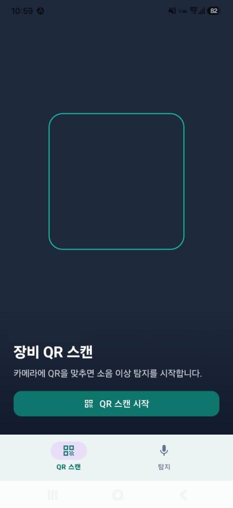
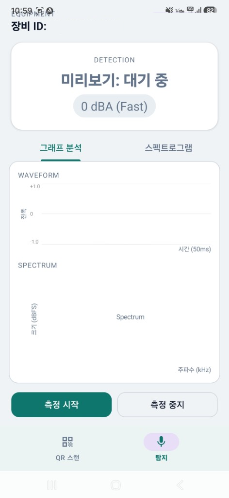
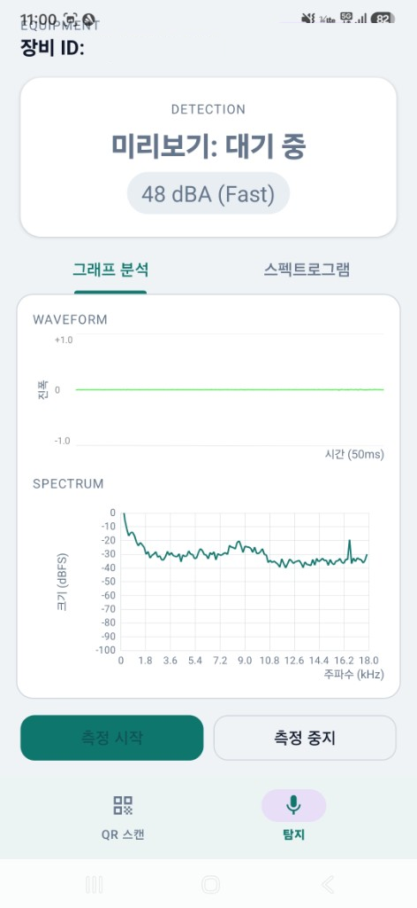
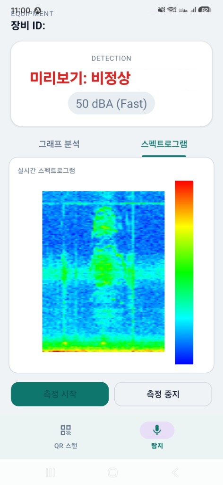

# 산업설비 소음 이상탐지

휴대폰으로 설비 운전 소음을 받아, 현장에서 이상 여부를 판정하는 앱입니다. 수집과 학습, 모델 배포는 서버가 맡습니다.

사내 측정 앱이라 스토어에는 없습니다.

## 무엇을 만들었나

측정부터 판정, 장비 구분, 모델 동기화까지 한 흐름으로 두었습니다.

| 구분 | 내용 |
|------|------|
| 측정 | 마이크 수집, 파형, 주파수, 스펙트로그램 |
| 판정 | 단말에서 모델을 실행하고 정상·이상을 표시 |
| 장비 | QR로 측정 대상을 구분 |
| 서버 | 수집, 학습, 평가, 앱으로 모델 동기화. 동기화 이후에는 오프라인으로 판정 |

화면 구현, 측정·판정 흐름, 서버 연동을 맡았습니다.

## 화면

아래 이미지는 화면 예시입니다. 장비 식별자와 판정에 붙는 숫자는 가렸고, 실제 설비 기록이 아닙니다.

| 파일 | 화면 |
|------|------|
| `images/01-qr.png` | 장비 QR 스캔 |
| `images/02-ready.png` | 장비 확인 후 측정 대기 |
| `images/03-waveform.png` | 그래프 분석. 측정 중 파형과 주파수 |
| `images/04-spectrogram.png` | 실시간 스펙트로그램과 판정 |

### 장비 QR 스캔

### 측정 대기

### 그래프 분석

### 스펙트로그램

측정 중 주파수 그림과 판정 상태가 같이 나옵니다.

## 기술

| 계층 | 사용 |
|------|------|
| 앱 | Kotlin, Android |
| 소리 처리 | NDK |
| 단말 실행 | TensorFlow Lite |
| 서버 | Python, FastAPI, Docker |

## 이 저장소에 없는 것

이 저장소는 결과와 구성을 보여 주는 포트폴리오입니다. 운영 중인 애플리케이션 소스, 모델, 학습 데이터, 판정 기준, 평가 기록은 올리지 않았습니다. 화면은 위 파일 이름의 사진으로만 확인합니다.
